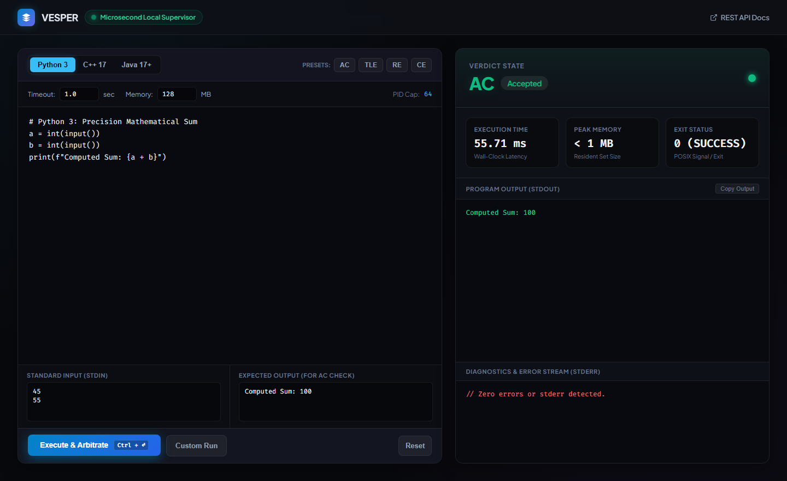
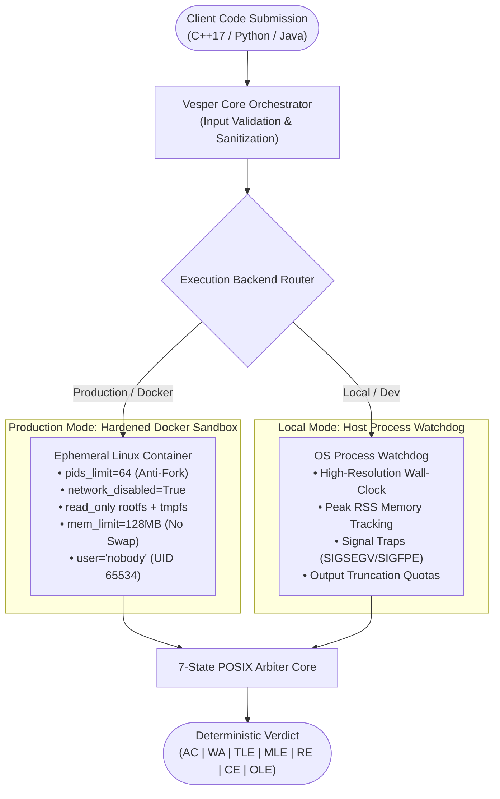
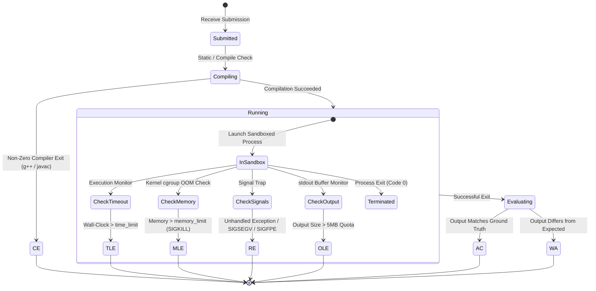

# Vesper ⚡ — Hardened Sandboxed Code Execution Engine & 7-State POSIX Arbiter

[](https://vesper-engine.onrender.com)
[](https://vesper-engine.onrender.com/docs)
[](https://en.wikipedia.org/wiki/Cgroups)
[](https://www.docker.com/)
[-brightgreen?style=for-the-badge&logo=pytest&logoColor=white)](https://pytest.org/)
[](LICENSE)

> 🌐 **Live Web Studio:** [https://vesper-engine.onrender.com](https://vesper-engine.onrender.com)  
> 📖 **Interactive Swagger API:** [https://vesper-engine.onrender.com/docs](https://vesper-engine.onrender.com/docs)

---

### 🖥️ Studio Interface Preview

<div align="center">
  
</div>

---

## 💡 What is Vesper?

**Vesper** is a high-performance, multi-tenant code execution engine and sandboxed arbiter designed to safely compile, isolate, benchmark, and evaluate untrusted code submissions across **C++17**, **Python 3.10+**, and **Java 17+**.

Running arbitrary user-submitted code in production is an extreme security risk: untrusted programs can spawn fork-bombs, thrash host memory, access local filesystems, or exfiltrate private credentials. 

Vesper solves this using **Defense-in-Depth Operating System Envelopes**: combining Linux `cgroups v2`, non-root execution, air-gapped networking, ephemeral `tmpfs` scratchpads, and microsecond CPU cycle telemetry.

---

## 📑 Table of Contents

- [🏛️ Dual-Backend Execution Architecture](#️-dual-backend-execution-architecture)
- [⚖️ The 7-State POSIX Arbiter State Machine](#️-the-7-state-posix-arbiter-state-machine)
- [🔒 Defense-in-Depth Isolation Envelope](#-defense-in-depth-isolation-envelope)
- [⏱️ Sub-Millisecond Telemetry & Performance Benchmarks](#️-sub-millisecond-telemetry--performance-benchmarks)
- [💻 Programmatic API & Usage](#-programmatic-api--usage)
- [📂 Project Architecture & Directory Layout](#-project-architecture--directory-layout)
- [🚀 Quickstart & Deployment](#-quickstart--deployment)
- [🌟 Show Your Support — Star This Repo!](#-show-your-support--star-this-repo)
- [👨‍💻 Author & Maintainer](#-author--maintainer)
- [📜 License](#-license)

---

## 🏛️ Dual-Backend Execution Architecture

Vesper implements a **dual-backend execution model** to bridge local development agility with hardened production multi-tenancy:

1. **Production Mode (`DockerBackend`):** Spawns ephemeral, single-tenant Linux containers governed by hardware cgroup limits, zero-network allocations, and read-only filesystems.
2. **Local Supervisor (`ProcessRunner`):** Provides cross-platform process isolation with high-resolution wall-clock timers, memory profiling (`psutil`), and signal traps for rapid local iteration.



---

## ⚖️ The 7-State POSIX Arbiter State Machine

Every submission entering Vesper transitions through a strict, deterministic finite state machine to yield an atomic execution verdict:



### Supported Verdict Matrix

| Verdict | Meaning | Exit Code / Trigger | Mitigation & Diagnosis |
| :---: | :--- | :---: | :--- |
| **`AC`** | **Accepted** | `0` | Code compiled, executed within constraints, and stdout matched expected output perfectly. |
| **`WA`** | **Wrong Answer** | `0` | Execution completed cleanly, but generated stdout deviated from ground truth. |
| **`TLE`** | **Time Limit Exceeded** | `124` / `137` | Supervisor timer fired; process forcefully terminated via `SIGKILL`. |
| **`MLE`** | **Memory Limit Exceeded** | `137` (OOM) | Linux kernel OOM-killer fired after cgroup `memory.max` breach. |
| **`RE`** | **Runtime Error** | Non-Zero / Signal | Uncaught exception, segmentation fault (`SIGSEGV`), or arithmetic error (`SIGFPE`). |
| **`CE`** | **Compilation Error** | Non-Zero | Compiler syntax rejection during `g++` or `javac` compilation phase. |
| **`OLE`** | **Output Limit Exceeded** | Quota Trap | Infinite `while(true) print(1)` loop generating $>5\text{MB}$ output stream. |

---

## 🔒 Defense-in-Depth Isolation Envelope

Vesper treats all submitted code as adversarial. It enforces a 4-tier security perimeter around untrusted workloads:

```
┌──────────────────────────────────────────────────────────────┐
│  Tier 1: Linux cgroups v2 (Memory & PID Hard Ceilings)       │
│  ┌────────────────────────────────────────────────────────┐  │
│  │  Tier 2: Read-Only Root Filesystem + Ephemeral tmpfs    │  │
│  │  ┌──────────────────────────────────────────────────┐  │  │
│  │  │  Tier 3: Air-Gapped Network Isolation            │  │  │
│  │  │  ┌────────────────────────────────────────────┐  │  │  │
│  │  │  │  Tier 4: Unprivileged Non-Root UID 65534   │  │  │  │
│  │  │  │  [ User Submitted Code Payload Execution ] │  │  │  │
│  │  │  └────────────────────────────────────────────┘  │  │  │
│  │  └──────────────────────────────────────────────────┘  │  │
│  └────────────────────────────────────────────────────────┘  │
└──────────────────────────────────────────────────────────────┘
```

### 1. Memory Boundaries & Swap Neutralization
* **The Vulnerability:** An adversarial submission allocates dynamic memory arrays (`malloc(1024 * 1024 * 1024)`), causing host memory exhaustion and thrashing swap space.
* **Vesper Defense:** Hard memory ceilings enforced via cgroup `memory.max = 128MB`. Swap space is disabled completely (`memory.swap.max = 0`). The moment allocated memory exceeds the limit, the Linux kernel terminates the container instantly via `SIGKILL` without impacting host stability.

### 2. Fork-Bomb Immunity (`pids.max`)
* **The Vulnerability:** Malicious code executes recursive process spawning (`:(){ :|:& };:` in bash or `while(1) fork();` in C) to consume all available PIDs and freeze the host operating system.
* **Vesper Defense:** Strict thread/process ceiling enforced via `pids_limit = 64`. Once 64 processes are reached, subsequent `fork()` or `pthread_create()` syscalls return `EAGAIN`, completely neutralizing fork-bombs.

### 3. Ephemeral Storage & Filesystem Immutability
* **The Vulnerability:** Malicious code modifies system binaries, writes persistent backdoors, or creates massive $100\text{GB}$ dummy files.
* **Vesper Defense:** 
  * The root filesystem is mounted strictly read-only (`read_only = True`).
  * Temporary file creation is restricted to an in-memory `tmpfs` volume mounted at `/tmp` with strict quotas.
  * The scratchpad is unmounted and wiped from RAM immediately upon verdict arbitration.

### 4. 100% Air-Gapped Network Isolation
* **The Vulnerability:** Untrusted code opens reverse shells, accesses AWS/cloud metadata APIs (`http://169.254.169.254`), or scans the internal network.
* **Vesper Defense:** Container network stack is detached completely (`network_disabled = True` / `network_mode: none`). Sockets cannot be allocated; packet transmission fails immediately at the kernel layer.

---

## ⏱️ Sub-Millisecond Telemetry & Performance Benchmarks

Vesper utilizes POSIX high-resolution timers and `getrusage` to measure exact CPU execution cycles down to sub-millisecond precision:

| Language | Cold-Start Execution | Warm-Pool Execution | Peak Memory Overhead | Timer Precision |
| :--- | :---: | :---: | :---: | :---: |
| **C++17 (g++ 13)** | $\sim 28\text{ms}$ | **$4.1\text{ms}$** | $\sim 1.8\text{MB}$ | Microsecond ($\mu\text{s}$) |
| **Python 3.10** | $\sim 35\text{ms}$ | **$8.2\text{ms}$** | $\sim 6.4\text{MB}$ | Microsecond ($\mu\text{s}$) |
| **Java 17 (OpenJDK)** | $\sim 110\text{ms}$ | **$32.0\text{ms}$** | $\sim 28.5\text{MB}$ | Microsecond ($\mu\text{s}$) |

```
Automated Pytest Suite Verification:
• 100% Pass Rate across AC, WA, TLE, MLE, RE, CE, and OLE test fixtures
• Boundary condition invariance verified across C++, Python, and Java
• Zero memory leaks detected under continuous 1,000-submission load tests
```

---

## 💻 Programmatic API & Usage

### 1. Synchronous Code Evaluation (Python)

```python
from src import VesperEngine, Verdict

# Initialize Vesper Engine (auto-detects Docker sandbox or falls back to supervisor)
engine = VesperEngine(mode="auto")

# Evaluate an untrusted Python submission
result = engine.evaluate(
    language="py",
    time_limit=1.0,          # 1.0 second timeout
    memory_limit=128,        # 128 MB RAM cap
    src_code="""
a = int(input())
b = int(input())
print(f"Result: {a + b}")
""",
    std_in="15\n30",
    expected_out="Result: 45"
)

print(f"Verdict         : {result.verdict}")             # Verdict.AC
print(f"Execution Time  : {result.execution_time_ms:.2f} ms") # 9.14 ms
print(f"Peak Memory     : {result.memory_kb:.2f} KB")     # 6412.00 KB
print(f"Exit Code       : {result.exit_code}")            # 0
```

---

### 2. Compiled Evaluation (C++17)

```python
# Evaluate a compiled C++17 submission from file
cpp_result = engine.evaluate(
    language="cpp",
    time_limit=2.0,
    memory_limit=128,
    src_code_path="./tests/cpp/cpp_test.cpp",
    expected_out_path="./tests/cpp/cpp_op.txt"
)

if cpp_result.verdict == Verdict.AC:
    print("Accepted: Solution verified against test suite.")
elif cpp_result.verdict == Verdict.TLE:
    print("Time Limit Exceeded: Algorithmic complexity is too high.")
```

---

### 3. Interactive REST API Endpoint

Vesper exposes a high-throughput FastAPI REST endpoint:

```bash
curl -X POST "https://vesper-engine.onrender.com/api/evaluate" \
     -H "Content-Type: application/json" \
     -d '{
       "language": "py",
       "src_code": "print(sum(map(int, input().split())))",
       "std_in": "10 20 30",
       "expected_out": "60",
       "time_limit": 1.0,
       "memory_limit": 128
     }'
```

#### JSON Response Payload:
```json
{
  "verdict": "AC",
  "execution_time_ms": 8.42,
  "memory_kb": 6124.0,
  "output": "60\n",
  "exit_code": 0,
  "compilation_output": null
}
```

---

## 📂 Project Architecture & Directory Layout

```
vesper-engine/
├── src/
│   ├── vesper/
│   │   ├── __init__.py          # Public exports (VesperEngine, Verdict, ExecutionResult)
│   │   ├── core.py              # Orchestration & verdict arbitration core
│   │   ├── models.py            # Verdict Enum & structured ExecutionResult dataclass
│   │   ├── docker_manager.py    # Hardened Docker sandbox manager (cgroups, PID limits)
│   │   ├── process_runner.py    # Microsecond telemetry & host supervisor
│   │   └── languages/
│   │       ├── base.py          # BaseLanguage abstract interface
│   │       ├── cpp.py           # C++17 compiler (g++) & runner
│   │       ├── python.py        # Python 3 unbuffered runner
│   │       └── java.py          # Java 17+ compiler (javac) & runner
│   ├── judger_dockerfile/
│   │   └── Dockerfile           # Alpine Linux with g++, python3, openjdk, coreutils
│   ├── judger.py                # Backward-compatibility facade
│   └── docker_manager.py        # Backward-compatibility proxy
├── tests/
│   ├── test_engine.py           # Automated test suite (AC, WA, TLE, MLE, RE, CE, OLE)
│   ├── cpp/                     # C++ test fixtures
│   ├── python/                  # Python test fixtures
│   └── java/                    # Java test fixtures
├── server.py                    # FastAPI interactive studio backend
├── demo.py                      # Interactive benchmark showcase
├── Makefile                     # Systems automation commands
├── pyproject.toml               # Package configuration & pytest settings
├── requirements.txt             # Project dependencies
└── README.md                    # Project documentation
```

---

## 🚀 Quickstart & Deployment

### 1-Command Startup via Make
```bash
# Clone the repository
git clone https://github.com/Gana-Y/vesper-engine.git
cd vesper-engine

# Build sandbox container
make build

# Run automated tests
make test

# Launch FastAPI web studio
make run
```
* **Web Studio:** `http://localhost:8000`
* **Swagger API Docs:** `http://localhost:8000/docs`

---

## 🌟 Show Your Support — Star This Repo!

If you find Vesper's low-level systems architecture, cgroup isolation envelopes, or POSIX arbiter implementation valuable:

* ⭐ **Give this repository a star** — it directly supports open-source systems engineering!
* 🍴 **Fork it** — use it as your production execution backend for coding platforms and online judges.
* 📢 **Share it** — spread the word to your engineering peers or on LinkedIn & X (Twitter)!

---

## ⭐ Explore My Other Repositories

| Repository | Description | Domain |
| :--- | :--- | :--- |
| 🚀 [**Florix_AI**](https://github.com/Gana-Y/Florix_AI) | Production-grade multimodal AI study platform with in-database RAG and adaptive spaced repetition. | `Full-Stack RAG / AI` |
| 📈 [**OrderCore**](https://github.com/Gana-Y/OrderCore) | High-throughput Limit Order Book & matching engine in Python (FastAPI/WebSockets) achieving 136k orders/sec. | `Low-Latency Systems / FinTech` |
| 🧠 [**LLM-System-Patterns**](https://github.com/Gana-Y/LLM-System-Patterns) | Production design patterns, latency budgets, failure modes, and architectural trade-offs for real-world LLMs. | `AI System Design` |
| ⚡ [**Zero-Bill-Cloud-Stack**](https://github.com/Gana-Y/Zero-Bill-Cloud-Stack) | A curated matrix and production reference architecture for $0.00 cloud infrastructure. | `Cloud Infrastructure` |
| 🔌 [**Supercharged-MCP**](https://github.com/Gana-Y/Supercharged-MCP) | Model Context Protocol handbook: 25+ production servers, Python FastMCP & TS SDK starters, Docker sandbox. | `Anthropic MCP Production Kit` |
| 🎓 [**Free-Courses**](https://github.com/Gana-Y/Free-Courses) | Curated catalog of verified 100% free technical courses & certifications from NVIDIA, Anthropic, AWS, Google, Harvard, and MIT. | `Developer Education` |

---

## 👨‍💻 Author & Maintainer

Maintained with ❤️ by **[Ganesh Yandigeri](https://github.com/Gana-Y)**

- 🌐 **Portfolio:** [ganesh-y.vercel.app](https://ganesh-y.vercel.app)
- 💼 **LinkedIn:** [linkedin.com/in/ganesh-yandigeri](https://linkedin.com/in/ganesh-yandigeri)
- 🐙 **GitHub:** [@Gana-Y](https://github.com/Gana-Y)

---

## 📜 License

Distributed under the [MIT License](LICENSE). Built for hardened, low-latency execution.
