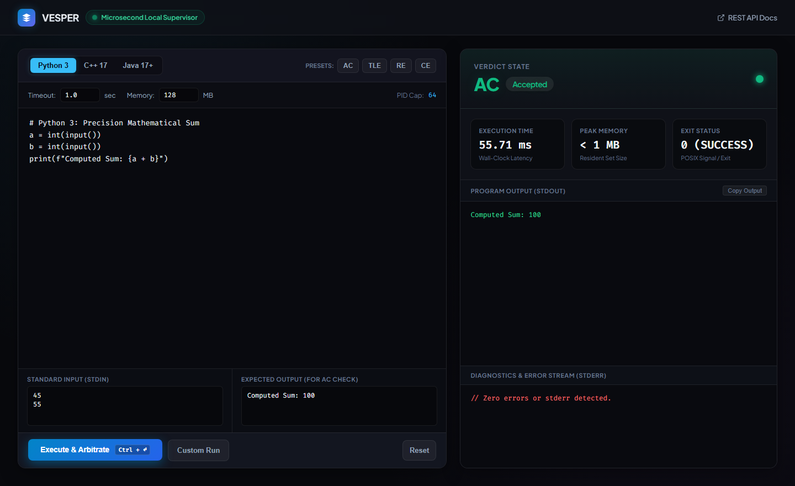

# Vesper 

> **Hardened, High-Performance Code Execution Engine & Sandboxed Arbiter**

[](https://vesper-engine.onrender.com)
[](https://vesper-engine.onrender.com/docs)
[](https://www.python.org/downloads/)
[](https://www.docker.com/)
[](LICENSE)
[]()

> 🌐 **Live Web Studio**: [https://vesper-engine.onrender.com](https://vesper-engine.onrender.com)  
> 📖 **Interactive REST API**: [https://vesper-engine.onrender.com/docs](https://vesper-engine.onrender.com/docs)

---

### 🖥️ Studio Interface Preview



---

**Vesper** is an isolated, multi-tenant code execution engine designed to compile, isolate, benchmark, and arbitrate untrusted code submissions. Built with strict defense-in-depth principles, Vesper enforces hardware-level Linux cgroup constraints, process quotas, and microsecond telemetry to safely evaluate competitive programming submissions across **C++17**, **Python 3**, and **Java 17+**.

---

## 🏛 Architecture Overview

Vesper utilizes a **dual-backend execution model**:
1. **Containerized Sandbox (`DockerBackend`)**: Spawns ephemeral, single-tenant sandboxes with cgroup limits, PID isolation, and disabled networking for production multi-tenancy.
2. **Local Supervisor (`ProcessRunner`)**: Provides cross-platform process isolation with microsecond timer resolution and peak RSS memory tracking for dev and testing environments.

```
                              +-----------------------+
                              |   Client Submission   |
                              +-----------+-----------+
                                          |
                                          v
                              +-----------------------+
                              |     Vesper Engine     |
                              |  (Orchestrator Core)  |
                              +-----------+-----------+
                                          |
               +--------------------------+--------------------------+
               |                                                     |
               v                                                     v
  [Production Mode: Docker]                             [Local Mode: Supervisor]
+-------------------------------+                     +-------------------------------+
| Ephemeral Linux Sandbox       |                     | Subprocess Watchdog           |
|  * pids_limit=64 (Anti-Fork)  |                     |  * Microsecond Wall-Clock     |
|  * network_disabled=True      |                     |  * Peak RSS Memory Profiling  |
|  * read_only rootfs + tmpfs   |                     |  * Output Size Quotas (OLE)   |
|  * mem_limit + memswap_limit  |                     |  * Signal Capture (SIGSEGV)   |
|  * user='nobody' (Non-root)   |                     +---------------+---------------+
+---------------+---------------+                                     |
                |                                                     |
                +--------------------------+--------------------------+
                                           |
                                           v
                             +---------------------------+
                             |    Verdict Arbitration    |
                             |  AC | WA | TLE | MLE | RE |
                             +---------------------------+
```

---

## 🔒 Security & Defense Envelopes

| Attack Vector | Vulnerability in Basic Judges | Vesper Defense Mechanism |
| :--- | :--- | :--- |
| **Fork Bombs** (`:(){ :|:& };:`) | Host OS PID exhaustion and freeze | Hardened `pids_limit=64` cap kills child thread generation |
| **Memory Exhaustion (OOM)** | Swap overflow & host thrashing | Strict `mem_limit` + `memswap_limit` matching bounds |
| **Network Probing / Exfiltration** | Malicious botnet / reverse shell | `network_disabled=True` (100% air-gapped container) |
| **Disk Exhaustion (DoS)** | Unbounded output file writes | 5 MB output truncation cap triggering `OLE` (Output Limit Exceeded) |
| **Filesystem Tampering** | Rootfs compromise or binary overwrite | `read_only=True` rootfs with isolated ephemeral `/tmp` tmpfs |
| **Privilege Escalation** | Root container breakout | Enforced unprivileged execution (`user='nobody'`) |

---

## ⚖ Supported Verdicts

- **`AC` (Accepted)**: Output matches expected ground truth within resource thresholds.
- **`WA` (Wrong Answer)**: Execution completed successfully, but output differed.
- **`TLE` (Time Limit Exceeded)**: Process exceeded allotted runtime (enforced via timeout supervisor).
- **`MLE` (Memory Limit Exceeded)**: Process terminated by kernel OOM killer.
- **`RE` (Runtime Error)**: Unhandled exception, Segmentation Fault (`SIGSEGV`), or Arithmetic Error (`SIGFPE`).
- **`CE` (Compilation Error)**: Compiler failed syntax or compilation phase (`g++`, `javac`, `py_compile`).
- **`OLE` (Output Limit Exceeded)**: Output stream exceeded disk protection boundary.

---

## 🚀 Installation & Quick Start

### 1. Requirements
- Python 3.8+
- Optional: Docker daemon (for containerized execution)
- Compilers: `g++`, `python3`, `javac` / `java`

### 2. Install Dependencies
```bash
pip install -r requirements.txt
```

### 3. Run the Showcase Demo
```bash
python demo.py
```

### 4. Run Automated Test Suite
```bash
python -m pytest -v
```

---

## 💻 Programmatic Usage

### Structured Engine API

```python
from src import VesperEngine, Verdict

# Initialize the engine (auto-detects Docker or falls back to local supervisor)
engine = VesperEngine(mode="auto")

# Evaluate a Python submission
result = engine.evaluate(
    language="py",
    time_limit=1.0,          # 1 second
    memory_limit=128,        # 128 MB
    src_code="""
a = int(input())
b = int(input())
print(f"Sum is {a + b}")
""",
    std_in="10\n25",
    expected_out="Sum is 35"
)

print(f"Verdict         : {result.verdict}")
print(f"Execution Time  : {result.execution_time_ms:.2f} ms")
print(f"Peak Memory     : {result.memory_kb:.2f} KB")
print(f"Output          : {result.output.strip()}")
```

### Evaluating Files (C++ / Java)

```python
# Evaluate C++ file
cpp_result = engine.evaluate(
    language="cpp",
    time_limit=2.0,
    memory_limit=128,
    src_code_path=r"./tests/cpp/cpp_test.cpp",
    expected_out_path=r"./tests/cpp/cpp_op.txt"
)
print(f"C++ Verdict: {cpp_result.verdict}")

# Evaluate Java file
java_result = engine.evaluate(
    language="java",
    time_limit=3.0,
    memory_limit=128,
    src_code_path=r"./tests/java/UserProgram.java",
    std_in="10\n20",
    expected_out="Sum: 30"
)
print(f"Java Verdict: {java_result.verdict}")
```

### Custom Test Runs (Without Expected Output)

```python
custom_res = engine.run_custom(
    language="py",
    time_limit=1.0,
    src_code="print('Testing custom output')",
    std_in=""
)
print(custom_res.output)
```

---

## 📂 Project Structure

```
OnlineJudge-Judger/
├── src/
│   ├── vesper/
│   │   ├── __init__.py          # Public exports (VesperEngine, Verdict, ExecutionResult)
│   │   ├── core.py              # Orchestration & verdict arbitration core
│   │   ├── models.py            # Verdict Enum & structured ExecutionResult dataclass
│   │   ├── docker_manager.py    # Hardened Docker sandbox manager (cgroups, PID limits)
│   │   ├── process_runner.py    # Microsecond telemetry & host supervisor
│   │   └── languages/
│   │       ├── base.py          # BaseLanguage abstract interface
│   │       ├── cpp.py           # C++17 compiler (g++) & runner
│   │       ├── python.py        # Python 3 unbuffered runner
│   │       └── java.py          # Java 17+ compiler (javac) & runner
│   ├── judger_dockerfile/
│   │   └── Dockerfile           # Alpine Linux with g++, python3, openjdk, coreutils
│   ├── judger.py                # Backward-compatibility facade
│   └── docker_manager.py        # Backward-compatibility proxy
├── tests/
│   ├── test_engine.py           # Automated test suite (AC, WA, TLE, RE, CE, OLE)
│   ├── cpp/                     # C++ test fixtures
│   ├── python/                  # Python test fixtures
│   └── java/                    # Java test fixtures
├── demo.py                      # Interactive benchmark showcase
├── pyproject.toml               # Package configuration & pytest settings
├── requirements.txt             # Project dependencies
└── README.md                    # Project documentation
```

---

## 📜 License

Distributed under the **MIT License**.
